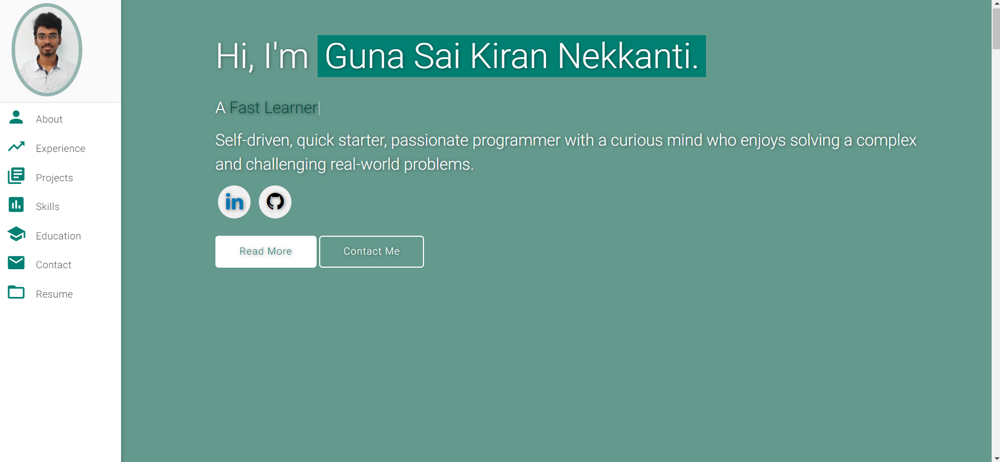

# Guna Sai Kiran Nekkanti 📡

> Wireless research engineer at Qualcomm, Bangalore. IISc gold medalist.
> I work on cellular positioning: working out where a phone is from the signals it trades with the network.

**Live site: [gunasaikiran.github.io](https://gunasaikiran.github.io)**

[](https://gunasaikiran.github.io)
[](https://github.com/Gunasaikiran/Gunasaikiran.github.io/commits/main)
[](https://www.linkedin.com/in/guna-sai-kiran-nekkanti-b526a2220/)
[](https://scholar.google.com/citations?hl=en&user=0Ulo0DEAAAAJ)
[](./LICENSE)

<p align="center">
  <a href="https://gunasaikiran.github.io" target="_blank">
    
  </a>
</p>

## What’s on the site ✨

- **A live opening screen.** A phone talks to a base station: signal packets go up and down, the tower’s beam follows the phone, and a circle shows the position estimate getting sharper. Tap anywhere to move the phone.
- **About.** A short intro, the IISc gold medal, and my tools shown as a moving signal spectrum.
- **Work.** A timeline that fills in as you scroll: Qualcomm, IISc, Bitmapper.
- **Research, with live demos.**
  - *Practical RIS gain without the pain*: the RIS points a random beam each slot, a user with a strong channel reports back, and the base station serves that user.
  - *3D-printed broadband absorber*: a radar pulse echoes off bare metal, but with the absorber on, nothing comes back.
- **Education.** IISc, IIIT Nagpur, Tirumala Junior College and Bhashyam Public School, with animated score rings.
- **Places.** A map of India with my home town, where I studied, where I live now, and every place I’ve travelled.
- **Share button.** Shows a QR code and a copy-link button, handy for sharing in person.
- **Light and dark mode**, mobile-first layout, and no motion for visitors who turn off animations on their device.

## Research 📄

| Work | Paper | Code |
|---|---|---|
| Practical RIS gain without the pain (M.Tech thesis, IISc) | [arXiv](https://arxiv.org/abs/2605.19787) | [GitHub](https://github.com/SPCLabIISc/2024_Guna_Sai_Kiran_MTech_ECE_Practical_RIS_Gain_without_Pain) |
| 3D-printed broadband FSS absorber, 8.5 to 29.2 GHz | [Taylor & Francis](https://www.tandfonline.com/doi/abs/10.1080/02726343.2025.2543371) | [GitHub](https://github.com/Gunasaikiran/FSS_BASED_ABSORBER) |

## Built with 🛠️

- Plain **HTML, CSS and JavaScript** in a single `index.html`, with no framework and no build step
- **Canvas** and **SVG** for every animation
- **Google Fonts**: Bricolage Grotesque and Literata
- **[QRCode.js](https://github.com/davidshimjs/qrcodejs)** for the share QR code
- **GitHub Pages** for hosting

## Run it locally 💻

Just open `index.html` in a browser. Or serve the folder:

```bash
python -m http.server 8000
# then visit http://localhost:8000
```

## Updating the site ✏️

Everything lives in `index.html`:

- **Add a place to the map:** find the `places` list and copy one line. Change the name, a few words in `tags`, the `state`, and the `lat` / `lon` coordinates.
- **Change the résumé:** search for `drive.google.com` and replace the link.
- **Change colours:** edit the colour variables at the top of the `<style>` block (`--teal`, `--saffron`, and so on).

## Contact 📬

- Email: [gunasaikiran8055@gmail.com](mailto:gunasaikiran8055@gmail.com)
- LinkedIn: [Guna Sai Kiran Nekkanti](https://www.linkedin.com/in/guna-sai-kiran-nekkanti-b526a2220/)
- Instagram: [@_sunny_insta_](https://www.instagram.com/_sunny_insta_/)

## License

MIT. See [LICENSE](./LICENSE). Feel free to borrow ideas; a link back is appreciated.
